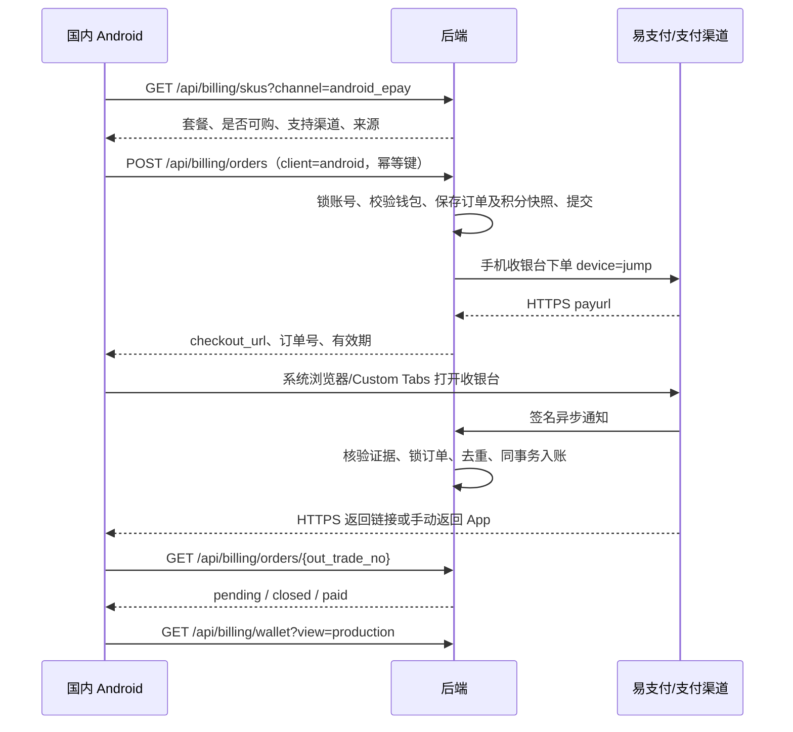

# 国内 Android 支付宝、微信接入

本期接入手机 HTTPS 收银台，复用现有易支付商户、四档套餐和 Production 统一积分钱包。不是支付宝/微信原生 SDK；供应商必须实际支持 device=jump 手机付款。配置登记不代表渠道已可售，不发起真实交易验收。

## 资金与来源

- 服务端生成 payment_client=android_domestic；Web 新订单为 web，历史空值按原支付渠道兼容推断。
- App 和 Web 可共用 Order 表与同一余额，但订单来源、资金来源与后台筛选独立。安卓资金批次为 android_epay_order，Web 为 web_order。
- 所有金额、积分来自服务端套餐快照。1 元人民币平台额度=100 积分，credit_fen 直接展示积分。
- 来源标记由服务端接口分支写入，客户端不能指定任意 payment_client。包名/版本头用于路由校验，不是安装包完整性认证。
- 国内安卓使用真实人民币付款与 Production 钱包；Apple 沙箱白名单不把此渠道变成沙箱。App 查询到账应指定 view=production。
- 签名、商户号、支付方式、金额、订单归属和网关交易号全部通过后才入账；浏览器回跳、客户端上报“成功”、二维码展示不构成付款凭证。
- 同订单行锁和交易号唯一约束保障并发回调幂等。订单 paid、资金批次、收据在同一事务中提交，失败全部回滚。
- 已关闭/本地过期订单若收到有效实付通知仍按原积分履约；关闭只是本地停止付款入口，不能取消供应商已发生的付款。

## 后台配置

路径：系统管理 → 支付配置 → App 复用网页支付。

复用上方易支付商户号、密钥及 HTTPS API。包名、证书指纹、返回协议均非付款必填项，相关字段收纳到「可选：支付后返回 App」：
- 可选国内包名；仅使用 HTTPS App Links 时需要配套发布签名 SHA-256 指纹。
- 可选公网 HTTPS 支付返回根站点，留空复用 public_base_url 对应的现有网站。
- 可选 App 返回协议，默认留空。只填 Scheme 可无包名/证书使用；客户端必须已经注册协议及支付返回路径。
- 额外收银台完整主机白名单，逗号分隔。不允许通配域名；API 自身主机默认受信。
- 手机支付宝/微信能力确认开关，以及国内安卓新购总开关，全部默认关闭。

启用前要求统一钱包已完成迁移并开启，环境 Production。停购仅阻止新订单，不拦截历史有效回调。收银台密钥随订单加密冻结，后续配置更改不会使用新密钥误验旧安卓订单；secret_key 丢失会导致无法解密，须保留部署密钥及备份。旧 Web 订单仍沿用其既有密钥处理规则。

支付配置不再显示订单列表。在原有「各渠道充值订单」中按国内 Android、Web、iOS、国际 Android 筛选。不会展示商户密钥、签名或收银台令牌，不提供“手工改已支付”按钮。统一资金对账支持单独识别安卓来源。

## 客户端流程



已按上一版 client=android、app_edition=domestic、幂等键及服务端查单流程接入的 App，本次无需修改。新增 payurl 为 checkout_url 的兼容别名，原字段保留。若 App 仅打开普通 Web 充值入口而未标明来源，仍需客户端或其打开的专用网页入口传递 App 来源；服务端不能仅凭手机 User-Agent 区分。返回 App 能力取决于已发布安装包，后台填配置不能替代客户端处理链接。

所有登录请求带 Authorization: Bearer <access_token>。推荐带 Accept-Language: zh-CN/en-US，以及：
```http
X-App-Package-Name: com.example.domestic
X-App-Edition: domestic
```
套餐、下单都使用同一包名和国内版本。Web 不传 Android 包名头。

### 1. 套餐

```http
GET /api/billing/skus?channel=android_epay&app_edition=domestic
```

可购示例（字段简写）：
```json
{
  "purchasing_enabled": true,
  "available": true,
  "payment_client": "android_domestic",
  "environment": "Production",
  "app_edition": "domestic",
  "pay_types": ["alipay", "wxpay"],
  "unavailable_reasons": [],
  "skus": [{"id":"topup_10","amount_fen":10000,"credit_fen":10000}]
}
```

固定套餐人民币售价/积分：topup_10=10000/10000，topup_49=49000/49000，topup_99=99000/104000，topup_199=199000/220000。接口返回实时共同套餐，客户端不硬编码价格。

不可购时 purchasing_enabled=false，items/skus/pay_types 为空。unavailable_reasons 是稳定配置原因代码，例如 unified_wallet_disabled、production_wallet_required、mobile_channels_disabled、configuration_incomplete。

### 2. 创建订单

```http
POST /api/billing/orders
Content-Type: application/json
Authorization: Bearer <access_token>
X-App-Package-Name: com.example.domestic
X-App-Edition: domestic
```
```json
{
  "client":"android",
  "app_edition":"domestic",
  "sku_id":"topup_10",
  "pay_type":"alipay",
  "idempotency_key":"客户端生成并持久化的唯一操作编号"
}
```

同一次购买重试必须使用原编号、原参数；不同参数复用键返回409。每账号每分钟最多5个新意向。重复键不重复请求供应商。不要在超时后自动换键重新付款。

正常响应：
```json
{
  "out_trade_no":"PFA0123456789abcdef0123456789abcdef",
  "payment_client":"android_domestic",
  "app_edition":"domestic",
  "environment":"Production",
  "pay_type":"alipay",
  "amount_fen":10000,
  "credit_fen":10000,
  "payment_currency":"CNY",
  "status":"pending",
  "checkout_status":"ready",
  "pay_mode":"redirect",
  "checkout_url":"https://供应商白名单主机/收银台路径",
  "payurl":"https://供应商白名单主机/收银台路径",
  "expire_seconds":290,
  "error_code":null
}
```

checkout_status=creating 表示供应商请求未完成或进程中断；uncertain 表示结果未知。此时 checkout_url=null，不提供二维码兜底。首次未知请求可能返回503 ANDROID_EPAY_CASHIER_UNCONFIRMED；用原幂等键重试可找回原订单，再查询订单状态。既不补发积分，也不自动重新向供应商下单。运营应查询供应商原订单并推动重发通知；当前未假设供应商存在统一主动查单 API。

### 3. 查订单与刷新积分

```http
GET /api/billing/orders/PFA0123456789abcdef0123456789abcdef
GET /api/billing/wallet?view=production
GET /api/billing/orders
```

订单只允许本人读取。详情返回 status、payment_client、environment、amount_fen、credit_fen、paid_at。
paid 才提示到账；pending 提示等待支付确认；closed 提示订单已本地关闭，若已扣款请继续核对原订单。
恢复前台、支付返回及网络重连都触发查订单。建议2秒间隔有限轮询最多60秒，之后保留订单入口让用户主动刷新。不要根据回跳参数修改余额，不因请求失败重下单。

## 回调、重试与退回 App

- 异步通知兼容 GET/POST /epay/notify 与 /api/billing/epay/notify，均经过资金维护屏障。
- 通知只接受有限长度表单与唯一参数名；伪签名、错误商户、错误渠道、金额不符和重复交易号串单拒绝，不入账。日志不输出密钥、完整签名/凭证。
- 商户回调地址须公网可达，不要配置局域网地址。部署代理必须把 /epay/notify 路由到 API，且不要跳转/要求登录。
- HTTPS 返回路径 /payments/return?order=PFA... 由 Web 处理。此页面无登录、不泄露订单归属、不判断是否支付，只提供返回 App。
- 客户端配置 Android App Links：
  - scheme=https，host=配置返回站点，pathPrefix=/payments/return，autoVerify=true。
  - ACTION_VIEW、CATEGORY_DEFAULT、CATEGORY_BROWSABLE。
  - 新增自定义 scheme 的 payments/return intent-filter，供页面按钮 intent://... 的包名绑定兜底。
  - 收到 HTTPS 或自定义协议只提取格式合法订单号，再请求服务端本人订单。
- /.well-known/assetlinks.json 同时提供原分享 App 及国内支付 App 的包名/证书关系；关闭分享或新购不移除已有付款返回的关联配置。
- Web 站点部署需为 /payments/return 提供前端 history fallback；/.well-known/assetlinks.json 必须代理到 API 并直返 JSON、无认证/重定向。
- Android 真机验证域名：adb shell pm verify-app-links --re-verify <package>，adb shell pm get-app-links <package>。微信内置浏览器可能限制唤起，需要引导外部浏览器或手动返回 App。

## 退款与上线边界

此期复用现有资金来源及核算能力，不新增供应商自动退款接口或伪造退款结果。渠道退款/撤销需按现有财务流程逐笔核对，不能直接删订单、改余额或把实付记为赠额。若业务要求全自动供应商退款，应先取得供应商退款、查单及通知规范后单独接入。

新增表和 orders.payment_client 通过 API 启动统一数据库锁幂等新增，不重算历史余额，不要求重新迁移旧账户。部署后先核验结构，再确认渠道移动收银台及签名通知。禁止因手机收银台失败回退为无来源 Web 下单。

代码测试不替代真机实付验收。上线前完成支付宝/微信各一笔真实小额或供应商测试交易、到账/重复通知/断网/返回 App/财务对账及退款演练；没有验收前保持新购关闭。没有在仓库内修改 Android 工程。
