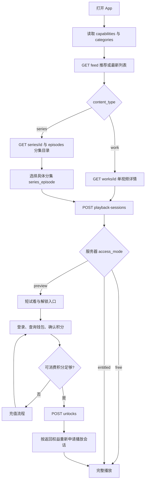
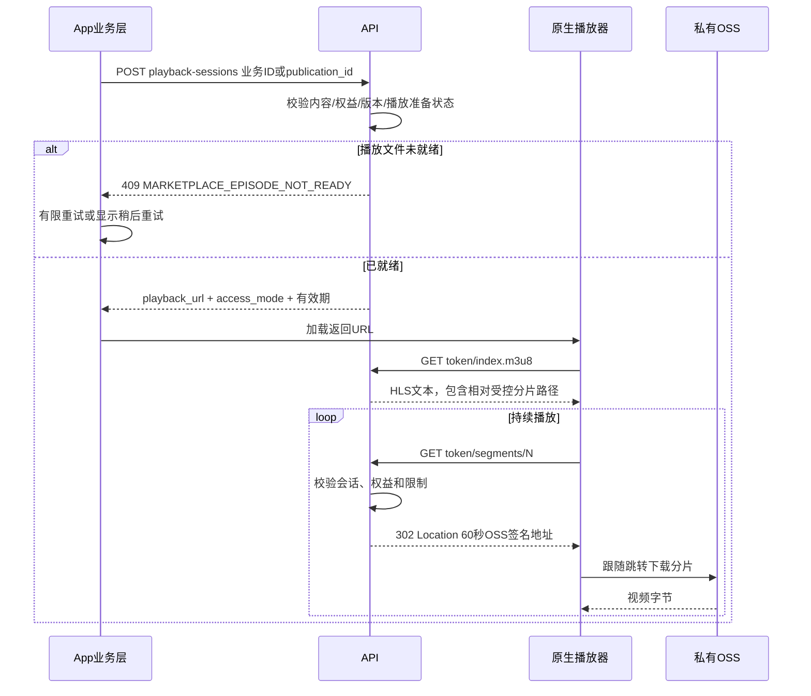
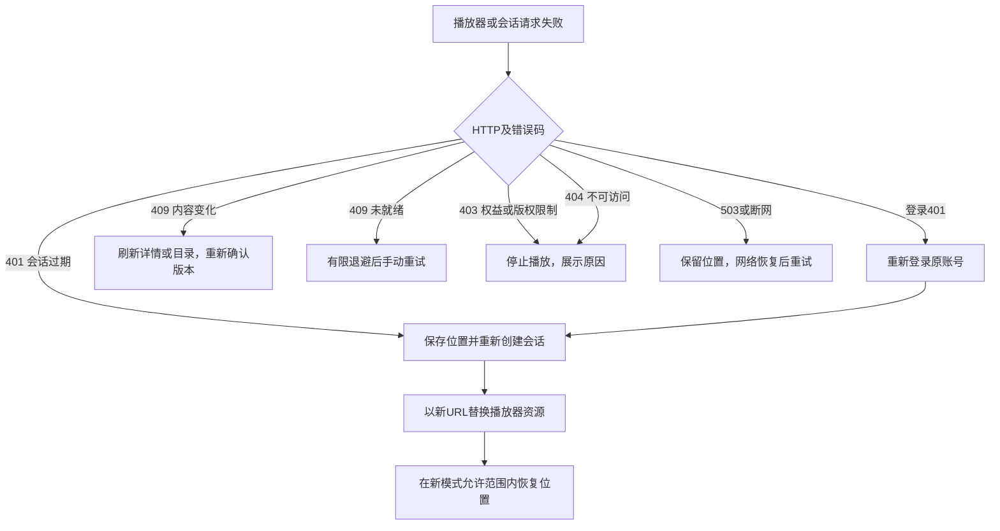
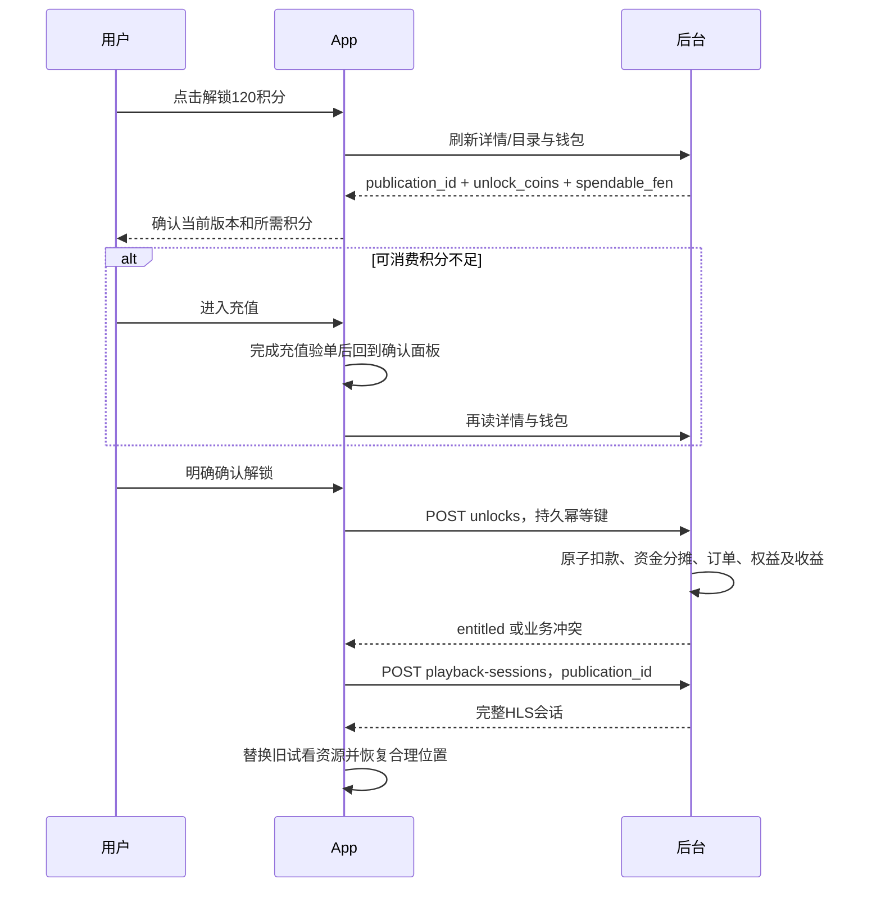
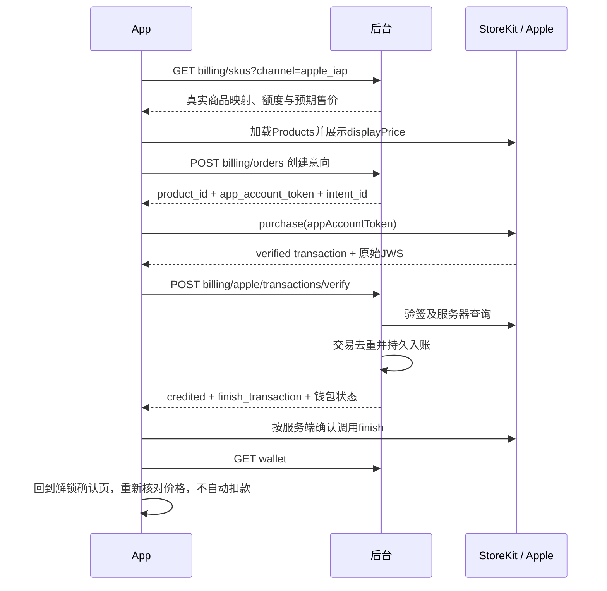

# App 视频前端接入详解

## 视频举报（iOS / Android）

`POST /api/marketplace/app/v1/reports`，必须携带 `Authorization: Bearer <token>`，可携带 `Accept-Language: zh-CN` 或 `en-US`。

```json
{
  "target_type": "work",
  "target_id": 101,
  "statement": "该作品疑似未经授权使用本人视频，请平台核查。",
  "contact": "reporter@example.com",
  "evidence_ids": []
}
```

单视频传 `work`，短剧当前分集传 `series_episode`；`target_id` 使用内容响应的 `content_id`（原作品或分集编号），不是 `publication_id`，也不接受 `episode` 或整个系列。举报说明10～5000字，联系方式1～200字；证据可省略，最多10个本人已上传且就绪的图片或文档资产 ID，不传图片 URL。用户填写的说明和联系方式保持原文。

成功返回 `200 {"id":123}`，表示举报已进入现有 Web 举报记录和后台处理流程，不表示作品已违规或被下架。证据和联系方式按现有私有权限处理，不公开给被举报者。游客返回401，参数不合法返回422；目标访问权限和证据所有权校验复用 Web。按钮提交时禁用，失败保留输入；当前没有举报请求幂等键，响应超时不要自动重试，以免生成重复举报。


时间格式更新（2026-11-09）：本前缀 JSON 响应的 `*_at` 字段统一返回北京时间（UTC+8）`YYYY-MM-DD HH:mm:ss`，例如 `2026-11-09 14:13:11`。不带微秒、T 或 Z，空值仍为 null。App 可直接展示，不得再加8小时；若转换设备当地时间，必须先按 UTC+8 解析。持续时长、数字时间戳和游标不变。统一充值 `/api/billing` 接口仍按其原时间协议处理。

核对日期：2026-11-06。依据当前仓库源码编写，不代表生产环境已经部署对应版本。本文说明已实现的接口与建议的客户端交互，**所有示例编号、标题、令牌和金额均为演示数据**，不是生产查询结果。接口示例展示所需字段，客户端须容忍额外字段；标注“节选”的响应不是完整响应。

交付配套：

- [可点击页面原型](prototypes/app-video.html)：浏览器打开，无外部依赖、无真实网络请求或扣款。
- [HTTP 请求集合](examples/app-video.http)：替换域名、Token、业务编号后用于联调，涉及充值和扣款的请求须在专用测试环境主动执行。
- [完整 App OpenAPI](openapi/marketplace-app-v1.json)。部分响应为自由字典，字段语义以本文和源码为准。
- [iOS 充值专项说明](IOS_RECHARGE.md)、[安卓分享接入](ANDROID_SHARING.md)、[互动运营与分享](MARKETPLACE_OPERATIONS.md)。

## 1. 页面和职责

建议客户端分为“发现、单视频播放页、短剧详情/选集、我的已购、钱包/充值”五个页面。播放页承载试看、完整播放、点赞收藏评论及分享；解锁使用底部确认面板，不需要为每部作品创建 Apple 商品。

后端负责分类、排序、可见性、免费判定、价格、版本、权益及资金；客户端负责展示、用户确认、播放器生命周期和有限重试。不得依据标题、中文类型名、参考价或运营数量推断收费权限。



## 2. 先统一编号、单位及请求约定

### 2.1 三类内容和发布版本

- `content_type=work`：单视频，`content_id` 是作品 ID，可播放、点赞、收藏、评论、分享。
- `content_type=series`：短剧系列，`id` 是系列 ID，只能进入目录；可点赞、收藏、评论、加精置顶展示，不能提交到播放会话或解锁接口，也不能创建全系列分享。
- `content_type=series_episode`：短剧分集，`content_id` 是分集自己的 `id`，**不是 `series_id`，也不是 `episode_no`**。可播放和逐集解锁；互动路径使用 `/episodes/{id}`。
- `version`：内容版本号，不能当主键使用。
- `publication_id`：已审核的发布快照 ID。解锁和历史已购播放以它为准；作者更新后新旧快照不同，不能用当前作品版本替换旧买家的快照。
- `session_id`：短期播放凭证，当前实现也是 URL 路径内的 token，不是用户 Token、内容 ID 或发布版本。
- `intent_id` / `order_id` / `out_trade_no`：充值意向、充值订单主键和充值订单号；与视频解锁订单不是一回事。

同一个数字可能同时出现在作品、系列和分集表。列表 Key 至少采用 `${content_type}:${id}`；已购列表 Key 用 `publication_id`。

### 2.2 积分与实付货币

余额、冻结、欠费、可消费额度及解锁使用原整数：`balance_fen=10000` 显示 **10,000 积分**，`unlock_coins=120` 显示 **120 积分**。`expected_coins` 直接提交120，不乘除100。

充值售价与消费额度分开：`expected_prices.USD=1499` 是 $14.99，`credit_fen=10000` 是到账10,000积分。充值实付、版权参考价、创作者收益仍是货币。不要把所有 `*_fen` 全局当积分；尤其解锁响应中的 `amount_fen` 是实付来源的人民币财务分摊，**不是本次扣除积分**。

### 2.3 基址、登录与语言

全文业务前缀 `APP=/api/marketplace/app/v1`，示例域名 `https://api.example.com` 需替换。分享域名可与 API 域名不同，以后台返回为准。正式环境使用有效 HTTPS；本地手机测试地址必须能从设备访问。

```http
Authorization: Bearer <PrintFilm登录access_token>
Accept-Language: zh-CN
Content-Type: application/json
```

游客浏览/试看/免费完整播放不带 Authorization；点赞、收藏、评论写入、充值、钱包和解锁要求登录。不要发送空字符串或过期 Bearer 冒充游客。iOS 凭证存 Keychain，Android 使用系统安全存储；当前接入不假设存在刷新 Token 接口，登录过期后走项目登录流程。

`Accept-Language` 支持 `zh-CN`、`en-US` 等；市场 JSON 响应包含 `Content-Language` 和 `Vary: Accept-Language`。业务逻辑读取固定代码，界面使用 `*_label`；用户标题、简介、标签和评论不自动翻译。缓存需区分用户和语言，游客数据不能覆盖登录用户权益。

### 2.4 登录示例

```http
POST /api/auth/login
Content-Type: application/json

{"email":"viewer@example.com","password":"<由用户输入>"}
```

```json
{"access_token":"<登录凭证，禁止写日志>","token_type":"bearer"}
```

登录后刷新详情、钱包和个人互动状态，不沿用游客的 `entitled=false`。退出登录时销毁原用户的已购播放会话和界面缓存；服务器播放 URL 本身是持有者凭证，不能让下一账号沿用。

## 3. 列表与分类：打开 App 到点击视频

### 3.1 读取能力

```http
GET /api/marketplace/app/v1/capabilities
Accept-Language: zh-CN
```

```json
{
  "enabled":true,"social_enabled":true,"comments_enabled":true,
  "sharing_enabled":true,"storage_configured":true,
  "apple_iap_enabled":true,"payments_configured":true,
  "purchasing_enabled":true,"unified_wallet_enabled":true,
  "environment":"Production","wallet_type":"platform_balance",
  "coin_value_fen":1,"offline_download":false,
  "supported_locales":["zh","en"],"default_locale":"zh"
}
```

`enabled` 控制 App 内容入口。配置完整不代表真实 OSS 或 Apple 已联调通过。`social_enabled`、`comments_enabled`、`sharing_enabled` 分别控制互动、评论写入和分享入口；内容自己的 `social.comments_enabled` 还可关闭评论写入，关闭后历史评论仍可读。

**充值开关注意：**此处 `purchasing_enabled` 还组合了 App 内容开放条件；统一余额充值本身不依赖市场入口。独立钱包充值页必须以 `/api/billing/skus?channel=apple_iap` 的可购结果为准，不因市场关闭而错误禁止有效付款验单。

### 3.2 获取分类

```http
GET /api/marketplace/app/v1/categories
Accept-Language: en-US
```

```json
{
  "version":3,
  "names":["短片","动画"],
  "items":[
    {"code":"short_film","name_zh":"短片","name_en":"Short Film","enabled":true,"aliases":["短片"],"label":"Short Film","translation_missing":false},
    {"code":"animation","name_zh":"动画","name_en":"Animation","enabled":true,"aliases":["动画"],"label":"Animation","translation_missing":false}
  ]
}
```

上例为只配置两类的演示。实际选项以 `items` 为准，`names` 是旧中文兼容值。显示 `label`，筛选传 `code`；不把英文名称存回 `category`。历史自定义分类可能缺英文，暂显示原名称。分类与内容形态分开：`short_film` 是分类，`work` 是内容形态。

### 3.3 获取内容流

```http
GET /api/marketplace/app/v1/feed?content_type=all&sort=recommended&category_code=short_film&limit=20
Accept-Language: zh-CN
```

可选参数：`q` 关键词（最多100字符，当前匹配标题）；`category_code`（最多80字符）；旧 `category`（中文兼容，代码优先）；`content_type=all|work|series`；`sort=recommended|latest`；`limit` 默认20、1～50；`cursor` 默认空、最多1024字符。

以下响应为一条收费单视频的完整业务字段示例，额外显示标签可能由语言中间件补充：

```json
{
  "items":[{
    "id":101,"content_type":"work","content_type_label":"单视频",
    "title":"山海来信","description":"一封来自海边的信。","version":3,
    "author":{"id":12,"name":"拾光影像","avatar_url":""},
    "creator":{"id":12,"name":"拾光影像","avatar_url":""},
    "category":"短片","category_code":"short_film","category_label":"短片",
    "category_labels":{"zh":"短片","en":"Short Film"},"tags":["剧情"],
    "sale_type":"platform_unlock","sale_type_label":"平台投放收益",
    "cover_url":"https://media.example.com/<临时签名封面>",
    "duration_seconds":120.0,"display_width":1080,"display_height":1920,"orientation":"portrait",
    "series_id":null,"episode_no":null,"publication_id":901,
    "is_free":false,"unlock_coins":120,"entitled":false,
    "access_mode":"preview","access_mode_label":"短试看",
    "playback_ready":true,"playback_status":"done","playback_status_label":"已完成",
    "engagement":{"like_count":6043,"comment_count":8,"favorite_count":3012,"share_count":1005,"liked_by_me":false,"favorited_by_me":false},
    "social":{"comments_enabled":true},"is_featured":true,"is_pinned":false,
    "created_at":"2026-11-06 14:00:00"
  }],
  "has_more":true,"next_cursor":"<服务端不透明游标>"
}
```

`author` 与 `creator` 当前提供同样结构，客户端选一套统一使用，建议 `creator`，兼容旧版时回落 `author`。`avatar_url=""` 用默认头像；封面为 null 或签名失效时显示占位，按需刷新详情，不持久缓存签名地址。

`orientation=landscape|portrait|square|null`；宽高、时长可空，不要强制解包。系列卡片的画幅取首集记录，播放某集时必须用该集的画幅。数量已经是后端合计值，前端不额外生成随机热度、不把系列分集数相加。

### 3.4 分页与刷新

```http
GET /api/marketplace/app/v1/feed?content_type=all&sort=recommended&category_code=short_film&limit=20&cursor=<上一页next_cursor经URL编码>
```

响应结构同上一节；没有后续页时 `has_more=false,next_cursor=null`。`items=[]` 不等于一定结束，仍以 `has_more` 为准，后台下架与页面读取并发时一页可能被过滤为空。

推荐按“置顶 → 置顶排序值 → 精选 → 时间 → 类型/ID”排序；最新严格按时间，客户端不要二次重排。运营排序更新返回：

```http
HTTP/1.1 409 Conflict
```

```json
{"detail":{"code":"MARKETPLACE_FEED_UPDATED","message":"列表已更新，请刷新"},"error":{"code":"MARKETPLACE_FEED_UPDATED","message":"列表已更新，请刷新","params":{}}}
```

收到该码丢弃旧分页与旧列表，重新请求第一页，不继续拼接。改变筛选、排序、账号时清空游标；语言切换重新获取显示数据，取消旧请求，防止旧语言响应回填。游标不可解析、截断或由页码生成，空格及全角空格也不能当空游标发送。

并发建议：列表状态维护 `queryKey + generation + loadingNext`；同一查询只允许一个翻页请求，旧 generation 响应丢弃，按复合 Key 去重。滚动离开的视频暂停，避免整个列表预加载所有 HLS 分片。

## 4. 详情与短剧选集

### 4.1 单视频详情

```http
GET /api/marketplace/app/v1/works/101
Authorization: Bearer <token，游客省略>
```

响应是第3.3节 `items[0]` 对象本身，**没有 `data` 包裹，也没有 `items`**。点击列表后刷新详情，以最新 `publication_id`、`unlock_coins` 和 `access_mode` 显示操作。

当前 App 只收录 `free` 和 `platform_unlock`，`copyright_contact` 不在发现流。`is_free` 是权威免费标识，不能通过 `unlock_coins==0` 或版权参考价为0推断可公开播放。

### 4.2 短剧系列详情

```http
GET /api/marketplace/app/v1/series/201
```

```json
{
  "id":201,"content_type":"series","title":"城市微光","description":"城市里的相遇。",
  "version":2,"category":"短剧","category_code":"short_drama","category_label":"短剧",
  "category_labels":{"zh":"短剧","en":"Short Drama"},"tags":["都市"],
  "sale_type":"platform_unlock","free_episode_count":1,"episode_count":8,
  "author":{"id":12,"name":"拾光影像","avatar_url":""},
  "creator":{"id":12,"name":"拾光影像","avatar_url":""},
  "cover_url":null,"display_width":1080,"display_height":1920,"orientation":"portrait",
  "engagement":{"like_count":43,"comment_count":2,"favorite_count":12,"share_count":0,"liked_by_me":false,"favorited_by_me":false},
  "social":{"comments_enabled":true},"is_featured":true,"is_pinned":true,
  "created_at":"2026-11-06 14:00:00"
}
```

示例省略本地化类型/收益标签。**系列响应没有单条视频的 `publication_id`、`unlock_coins`、`access_mode` 和可播放 URL**。不要给系列显示“一键解锁整部”，也不要默认系列中所有分集都是免费或收费；系列收藏与分集收藏独立。

### 4.3 分集目录

```http
GET /api/marketplace/app/v1/series/201/episodes?limit=20
Authorization: Bearer <token，游客省略>
```

```json
{
  "items":[
    {"id":301,"content_type":"series_episode","series_id":201,"episode_no":1,"title":"相遇","version":2,"publication_id":911,"is_free":true,"unlock_coins":0,"entitled":false,"access_mode":"free","playback_ready":true,"playback_status":"done","duration_seconds":90.0},
    {"id":302,"content_type":"series_episode","series_id":201,"episode_no":2,"title":"来信","version":2,"publication_id":912,"is_free":false,"unlock_coins":120,"entitled":false,"access_mode":"preview","playback_ready":true,"playback_status":"done","duration_seconds":100.0}
  ],
  "has_more":false,"next_cursor":null
}
```

分集对象为第3.3节同一视频字段结构，以上为节选；带各集的作者、封面、画幅和互动数。按 `episode_no` 升序分页，参数 `limit/cursor` 同目录定义；追加页传原 `next_cursor`。不要拿 feed 游标查目录。

当前没有独立 `GET /episodes/{id}` 详情接口。通过系列目录取得分集信息；分享指定集落地时用返回的 `series_id/episode_id` 逐页定位，不能假设目标在第一页。播放接口可直接提交已知分集 ID，但价格确认仍应读取目录中最新发布信息。

自动下一集只能切换到已取到的相邻分集，随后由服务器判定免费/已购/试看；**不能自动调用解锁扣款**。当前也没有服务端观看进度/历史 API，续播进度由客户端按“账号、类型、内容ID、发布版本”持久保存，不能宣称支持跨设备进度同步。

## 5. 播放：会话、清单、分片和过期恢复



### 5.1 创建当前内容播放会话

```http
POST /api/marketplace/app/v1/playback-sessions
Authorization: Bearer <token，游客省略>
Content-Type: application/json

{"content_type":"work","content_id":101}
```

分集请求只替换定位信息：

```json
{"content_type":"series_episode","content_id":302}
```

成功响应：

```json
{
  "session_id":"<短期播放令牌>",
  "playback_url":"https://api.example.com/api/marketplace/app/v1/playback-sessions/<短期播放令牌>/index.m3u8",
  "format":"hls","access_mode":"preview","publication_id":912,
  "expires_in":1800,"max_lifetime_seconds":7200
}
```

不加购时后端返回 `preview`，免费返回 `free`，持有当前版本有效权益返回 `entitled`。**以响应决定播放器模式**，不要仅根据列表先前状态决定。试看无烧录水印，最长15秒且不超过原片时长30%；120秒原片最多15秒，20秒原片最多6秒。播放器进度条按实际 HLS 时间轴，列表 `duration_seconds` 是原片时长，不是试看时长。

`expires_in` 是空闲有效期，默认1800秒，可由服务端缩短；`max_lifetime_seconds` 默认7200秒。持续请求会话可延长空闲期，但不超过最长生命周期。不要把 `expires_in` 当作固定整片时长或假定播放满30分钟一定中断。

### 5.2 历史已购版本播放

```http
POST /api/marketplace/app/v1/playback-sessions
Authorization: Bearer <token>
Content-Type: application/json

{"publication_id":900}
```

响应格式同上，`access_mode="entitled"`，`publication_id=900`。请求中只能选一种定位方式，不能同时传 `publication_id` 和 `content_type/content_id`；不能传 OSS 地址、HLS 地址或资产路径。已购页点击必须走该方式，避免作者更新后误播新版或要求重复购买。

历史权益不因作者主动下架自动失效，但封禁、删除及权属限制仍可拒绝播放。当前内容详情404不一定表示历史已购权益失效；查询已购列表并按旧 `publication_id` 尝试。

### 5.3 播放器自动请求清单

```http
GET /api/marketplace/app/v1/playback-sessions/<token>/index.m3u8
```

```http
HTTP/1.1 200 OK
Content-Type: application/vnd.apple.mpegurl
Cache-Control: private, no-store
```

```m3u8
#EXTM3U
#EXT-X-VERSION:3
#EXT-X-TARGETDURATION:6
#EXT-X-MEDIA-SEQUENCE:0
#EXTINF:6.000000,
segments/0
#EXTINF:6.000000,
segments/1
#EXT-X-ENDLIST
```

分片数量、时长和实际头部以真实清单为准，不硬编码。iOS 将 `playback_url` 交给 AVPlayer；Android 使用支持 HLS 的 Media3/ExoPlayer 模块。保留原 URL 的相对路径解析，不把清单当 JSON，也不手工将其替换成原片播放地址。

### 5.4 播放器自动请求分片

```http
GET /api/marketplace/app/v1/playback-sessions/<token>/segments/0
```

```http
HTTP/1.1 302 Found
Location: https://实际OSS域名/<私有分片>?<有效60秒的签名参数>
Cache-Control: private, no-store
```

302是正常播放流程，不是失败。播放器需允许 API HTTPS 跳转到合法 OSS HTTPS 地址；CDN/代理不能吞掉 Location。清单与分片接口当前依赖 URL 中的会话凭证，不要求播放器重复加登录 Bearer。不要向跨域 OSS 附带账号 Authorization，也不要把签名地址缓存到下一次播放。

API 域名是权限入口，OSS 仍承担分片流量；返回 API 播放 URL 并不意味着把原片改存 API。当前代码在清单与分片请求时重新校验权限，不承诺已缓存字节能在退款瞬间撤回。

### 5.5 播放准备与故障恢复

`playback_status` 当前为 `pending/running/done/failed`；没有记录时详情也返回 `pending`。`playback_ready` 是**当前访问模式对应的派生文件**：未购收费视频通常指短试看 HLS，已购/免费指完整 HLS，不能用它保证解锁所需的完整 HLS 已就绪。

首次创建会话可能排队准备播放文件并返回409，这不代表要付款。不要在 `playback_ready=false` 时永久禁用播放按钮，否则可能无法触发会话准备。建议“准备播放”状态允许发起一次会话，再按约2/4/8秒退避、前台总计约30秒有限重试；这是客户端建议，不是服务器时限保证。失败或超时显示手动重试，不死循环轮询；后台没有给 App 提供独立媒体任务进度/重跑接口。



播放器错误不一定直接暴露服务端 JSON；业务层结合原生错误、会话重新申请结果确定原因。区分“播放URL401”和“账号API401”，不能所有401都踢回登录。

切换视频、切集或账号后，取消旧加载与重试；每个播放器资源绑定请求 generation，防止 A 视频晚到响应覆盖 B。位置仅在同一内容/版本上恢复，试看不能 seek 到原片的收费区间。超过2小时或暂停过期后新建会话，而不是反复重试旧 OSS URL。

## 6. 收费视频解锁：登录、余额和扣款



### 6.1 读取统一钱包（推荐）

```http
GET /api/billing/wallet
Authorization: Bearer <token>
```

```json
{
  "balance_fen":10000,"frozen_fen":500,"balance_yuan":100.0,"frozen_yuan":5.0,
  "plan":"free","billing_enabled":true,"markup":1.0,
  "unified_wallet_enabled":true,"debt_fen":0,
  "pending_commitment_fen":1000,"spendable_fen":9000,
  "refund_pending":false,"environment":"Production"
}
```

`markup` 取系统实际值，示例1.0非固定合同。解锁前显示可消费 `spendable_fen`，不能只看 `balance_fen`。冻结额已经不在可用余额里，**不要再从 `spendable_fen` 减一次冻结**；排队任务占用、欠费或退款待处理可导致可消费低于余额。统一钱包未启用时该接口不一定包含新字段，App 应提示当前付费服务未就绪，不自行推算余额来解锁。

### 6.2 App 兼容钱包

```http
GET /api/marketplace/app/v1/me/wallet
Authorization: Bearer <token>
```

```json
{
  "balance_fen":10000,"frozen_fen":500,"debt_fen":0,"pending_commitment_fen":1000,
  "spendable_fen":9000,"refund_pending":false,"environment":"Production",
  "balance_coins":10000,"frozen_coins":500,"debt_coins":0,"spendable_coins":9000,
  "coin_name":"平台余额","coins_per_yuan":100,"wallet_type":"platform_balance"
}
```

两个钱包接口是同一份余额，选一个作为客户端权威来源即可，不并发读后相加。页面统一称“积分”，不沿用响应 `coin_name` 改回人民币余额。查询钱包是查询，不是预占本次解锁资金，真正扣款仍须服务端事务核验。

### 6.3 提交解锁

```http
POST /api/marketplace/app/v1/unlocks
Authorization: Bearer <token>
Content-Type: application/json

{"publication_id":912,"expected_coins":120,"idempotency_key":"unlock-6d0f0fd4-03d1-4f34-8386-e91d125072a8"}
```

三个字段必填，拒绝多余字段：`publication_id>0`；`expected_coins` 是大于0的严格整数；幂等键长度8～128。建议使用随机 UUID 前缀键。首次点击确认前持久保存“账号、环境、发布版本、价格、幂等键”操作记录；同一次网络重试复用原记录。按钮防双击只是体验，不能替代后端幂等。

首次成功示例：

```json
{
  "id":801,"order_id":701,"publication_id":912,"environment":"Production",
  "coins":120,"amount_fen":100,"status":"paid","created_at":"2026-11-06 15:00:00",
  "entitled":true,"charged_coins":120,"balance_coins":9880,"balance_fen":9880
}
```

这里演示120积分来自包含赠额的资金来源，人民币实付分摊100分；显示“已扣120积分”，不要显示“已扣100积分”。成功不保证含 `duplicate:false`，不要强依赖该字段。

已拥有权益且使用新操作键时，可返回更短对象：

```json
{"publication_id":912,"entitled":true,"duplicate":true,"charged_coins":0}
```

同键重试则可能返回原订单字段、`entitled` 和 `duplicate:true`，不保证带 `charged_coins/balance_fen`。统一按 `entitled` 判断，再刷新钱包和已购；不能用响应是否带 `id` 判断成功。旧订单已被退款撤权后，重试旧键可能 `entitled=false`，不能显示“已解锁”；重新确认购买需新键。

### 6.4 解锁后的动作与冲突

成功后用 `{"publication_id":912}` 重新创建播放会话，加载新完整 HLS，刷新目录/详情和钱包。旧试看会话不会自动升级。余额足够不代表一定可售：价格、发布版本、上架状态、完整 HLS、账号欠费和作者身份都可能阻止扣款。

- `MARKETPLACE_COIN_BALANCE_INSUFFICIENT`：可消费不足/AI预留，刷新钱包并提供充值入口，不重复扣款。
- `MARKETPLACE_CONTENT_CHANGED`：版本、价格或收费方式变化，刷新并让用户重新确认；不要无提示购买新版。
- `MARKETPLACE_EPISODE_NOT_READY`：完整 HLS 未就绪，暂不扣款；不能因为试看就绪就显示购买必定成功。
- `MARKETPLACE_IDEMPOTENCY_CONFLICT`：同键已用于别的目标/价格，停止自动重试并检查本地操作记录。
- `MARKETPLACE_SELF_PURCHASE`：不能购买自己的作品，不替用户绕过。
- `WALLET_DEBT_OUTSTANDING` / `WALLET_REFUND_PENDING`：按欠费或退款处理中提示，不能假定充值后全部可消费。

网络超时无法判断是否已扣款时：保留原幂等键，恢复后重试原请求/查询已购；严禁立即生成新键再次扣款。并发双设备由后端串行及权益幂等保护，客户端也应及时刷新。

## 7. 余额不足：iOS 充值闭环



### 7.1 获取 Apple 套餐

```http
GET /api/billing/skus?channel=apple_iap
Accept-Language: zh-CN
```

```json
{
  "purchasing_enabled":true,"environment":"Production","currency":"CNY",
  "credit_currency":"CNY","supported_payment_currencies":["CNY","USD"],"coins_per_yuan":100,
  "items":[{"id":"topup_10","sku_id":"topup_10","name":"入门充值包","product_id":"com.deep.printfilm.credits.topup_10","amount_fen":10000,"credit_fen":10000,"coins":10000,"bonus_fen":0,"reference_price_fen":10000,"price_fen":10000,"credit_currency":"CNY","expected_prices":{"CNY":10000,"USD":1499}}],
  "skus":[{"id":"topup_10","sku_id":"topup_10","name":"入门充值包","product_id":"com.deep.printfilm.credits.topup_10","amount_fen":10000,"credit_fen":10000,"coins":10000,"bonus_fen":0,"reference_price_fen":10000,"price_fen":10000,"credit_currency":"CNY","expected_prices":{"CNY":10000,"USD":1499}}],
  "pay_types":["apple_iap"]
}
```

单档示例，`name` 取后台套餐快照；`items/skus` 是兼容别名，不能当成两组商品重复显示。四档到账10,000/49,000/104,000/220,000积分，对应人民币¥100/490/990/1,990和美元$14.99/69.99/139.99/279.99。StoreKit 实际商品必须存在且币种、金额符合预期；展示 `displayPrice`，不拿人民币分格式化成美元。

### 7.2 创建统一充值订单

```http
POST /api/billing/orders
Authorization: Bearer <token>
Content-Type: application/json

{"sku_id":"topup_10","pay_type":"apple_iap","idempotency_key":"recharge-5929b884-89bc-40b6-bd4c-1eea91cc0894"}
```

```json
{
  "intent_id":501,"order_id":601,"out_trade_no":"IAP-I-<服务端订单号>",
  "sku_id":"topup_10","product_id":"com.deep.printfilm.credits.topup_10",
  "credit_fen":10000,"coins":10000,"price_fen":10000,"amount_fen":10000,
  "currency":"CNY","credit_currency":"CNY",
  "app_account_token":"<服务端稳定UUID>",
  "expected_prices":{"CNY":10000,"USD":1499},
  "environment":"Production","expires_at":"2026-11-06T07:30:00Z"
}
```

创建意向不是已付款。用返回 UUID 作为 StoreKit `appAccountToken`。充值与解锁分别维护幂等键，不能复用同一业务记录；用户明确发起新一笔充值才创建新键。未完成交易响应丢失只重验原交易，不能再发起 Apple 购买。

### 7.3 提交 Apple 交易验单

```http
POST /api/billing/apple/transactions/verify
Authorization: Bearer <token>
Content-Type: application/json

{"signed_transaction_info":"<StoreKit transaction.jwsRepresentation原文>","intent_id":501}
```

```json
{
  "transaction_id":"<Apple交易号>","environment":"Production","order_id":601,
  "status":"paid","coins":10000,"amount_fen":10000,"currency":"CNY",
  "credited":true,"finish_transaction":true,"payment_amount_minor":10000,
  "credit_currency":"CNY","valuation_status":"valued","message":"平台余额充值已确认。",
  "balance_fen":10000,"balance_coins":10000,"frozen_fen":0,"debt_fen":0,
  "pending_commitment_fen":0,"spendable_fen":10000,"refund_pending":false
}
```

此响应为CNY演示，核算状态实际以服务器返回为准。恢复未完成交易可以省略 `intent_id`，服务端仍验证账号归属。`credited=true` 表示充值已确认，但可能先抵扣欠费，不能假设可消费余额必增全部套餐额度。`finish_transaction=true` 后才 `finish()`；退款终态也可能允许 finish，但 `credited=false`，不能显示到账成功。

Apple 显示付款成功而后台仍待支付时，首先核对是否真的提交了此验单接口以及返回结果。只轮询充值订单、只调用 `finish()` 或只看 StoreKit success 都不能完成服务端入账；本地无公网通知时，客户端主动验单仍是必要测试路径，后台还必须能连接 Apple 服务器。

### 7.4 查询充值订单（辅助展示）

```http
GET /api/billing/orders/IAP-I-<订单号>
Authorization: Bearer <token>
```

```json
{"out_trade_no":"IAP-I-<订单号>","status":"paid","amount_fen":10000,"credit_fen":10000,"pay_type":"apple_iap","paid_at":"2026-11-06T07:05:00+00:00"}
```

响应节选，可能包含额外付款快照字段。查询不触发 Apple 验单，不替代验单请求。充值订单历史状态要结合最新验单/退款及钱包读取，不作为客户端推断可播放权益的唯一依据。

App 启动监听 `Transaction.updates`；登录原账号、前台恢复和网络恢复时处理 `Transaction.unfinished`，串行提交原交易。取消购买不提示成功，pending显示等待批准；未确认到账不 finish。消耗型充值不能靠系统“恢复购买”重建余额，重装后登录 PrintFilm 账号读取服务端钱包与权益。

Apple 通知 `POST /api/billing/apple/notifications` 是 Apple 到后台的服务端回调，**不是 App 要主动调用的付款完成接口**。Android 分享接入不等于已实现 Google Play Billing；本期不在安卓中照搬 StoreKit，也不新增未实现的安卓支付渠道。

## 8. 我的已购、订单和资金流水

### 8.1 已购权益列表

```http
GET /api/marketplace/app/v1/me/entitlements?limit=20
Authorization: Bearer <token>
```

```json
{
  "items":[{
    "id":101,"publication_id":900,"content_type":"work","content_id":101,"version":2,"title":"山海来信",
    "creator":{"id":12,"name":"创作者","avatar_url":null},
    "engagement":{"like_count":6007,"comment_count":2,"favorite_count":3003,"share_count":901,"liked_by_me":true,"favorited_by_me":true},
    "social":{"comments_enabled":true,"interaction_available":true},
    "cover_url":null,"duration_seconds":118.0,"display_width":1080,"display_height":1920,"orientation":"portrait",
    "series_id":null,"episode_no":null,"playback_ready":true,"restricted_reason":"","permanent":true
  }],"has_more":false,"next_cursor":null
}
```

查询参数 `limit` 1～50默认20，下一页传原不透明 `cursor`。不要拿 `version=2` 拼成当前内容 ID。`restricted_reason` 非空时保留记录并展示原因；`permanent=true` 表示权益期限，不代表永远忽略退款或版权限制。标题可能读当前内容名，不能据此认为已购资产已更新。

点击已购条目后获取详情：

```http
GET /api/marketplace/app/v1/me/entitlements/900
Authorization: Bearer <token>
```

响应为上面单个 `items` 条目，包含相同的创作者、互动、历史媒体和播放状态字段。无权益、权益已撤销、交易环境不匹配或编号不存在统一返回 `403 MARKETPLACE_ENTITLEMENT_REQUIRED`。游客返回401。

接入顺序：已购列表 → 按 `publication_id` 获取已购详情 → `POST /playback-sessions` 提交 `{"publication_id":900}` → 加载播放地址。播放会话接口不返回互动数据，页面从已购详情读取。

互动归属原作品或分集，不按购买版本拆分：`content_type=work` 使用 `/works/{content_id}/…`；`content_type=series_episode` 使用 `/episodes/{content_id}/…`，不能把 `publication_id` 当作互动目标。数量包含运营初始值，个人状态只来自真实记录。

媒体、封面和版本来自购买快照；标题、创作者资料和互动数据读取当前信息。`social.interaction_available=false` 时禁止新增互动，但不要因此禁止仍有权益的历史播放。下架作品仍可播放已购版本；封禁或版权限制等以 `restricted_reason` 为准，受限记录的互动数量与个人状态不公开展示。

### 8.2 视频解锁订单

```http
GET /api/marketplace/app/v1/me/unlock-orders?page_size=20
Authorization: Bearer <token>
```

```json
{"items":[{"id":801,"order_id":701,"publication_id":912,"environment":"Production","coins":120,"amount_fen":100,"status":"paid","created_at":"2026-11-06 15:00:00"}],"has_more":false,"next_cursor":null}
```

下一页用数字 `cursor=<上一页next_cursor>`，不是 feed 的签名游标；`page_size` 默认20、1～50。这里保留撤销历史，状态与权益列表共同展示，不把历史 paid 记录自行转成播放权限。

### 8.3 平台余额流水

```http
GET /api/marketplace/app/v1/me/wallet/entries?page_size=20
Authorization: Bearer <token>
```

```json
{"items":[{"id":1001,"kind":"consume","coins_delta":-120,"delta_fen":-120,"balance_after":9880,"created_at":"2026-11-06 15:00:00"}],"has_more":false,"next_cursor":null}
```

示例 `kind` 以实际服务端为准，客户端为未知 kind 提供通用描述，不限制为只有视频消费。这里包含 Web充值、Apple充值和 AI 消费，同一份资金历史；`coins_delta/delta_fen/balance_after` 显示积分。下一页数字 cursor，范围同解锁订单。

## 9. 播放页互动和分享（补充）

### 9.1 点赞、收藏

```http
PUT /api/marketplace/app/v1/works/101/like
DELETE /api/marketplace/app/v1/works/101/like
PUT /api/marketplace/app/v1/works/101/favorite
DELETE /api/marketplace/app/v1/works/101/favorite
Authorization: Bearer <token>
```

四个请求都无业务正文。示例响应：

```json
{"ok":true,"engagement":{"like_count":6044,"comment_count":8,"favorite_count":3012,"share_count":1005,"liked_by_me":true,"favorited_by_me":false,"comments_enabled":true}}
```

分集将路径替换为 `/episodes/302/...`，系列用 `/series/201/...`。DELETE返回取消后的同样结构；覆盖数量和个人状态，不额外加减服务端计数。支持乐观更新，失败回滚；同一目标的连续点击串行或合并意图，避免晚到响应覆盖新状态。

### 9.2 评论读取和发送

```http
GET /api/marketplace/app/v1/works/101/comments?sort=latest&limit=20
```

```json
{"items":[{"id":1101,"user_id":88,"text":"这一段镜头很好看。","status":"visible","parent_id":null,"reply_count":1,"created_at":"2026-11-06 15:00:00"}],"has_more":false,"next_cursor":null}
```

```http
POST /api/marketplace/app/v1/works/101/comments
Authorization: Bearer <token>
Content-Type: application/json

{"text":"喜欢这个故事。","parent_id":null}
```

```json
{"id":1102,"text":"喜欢这个故事。","status":"visible","parent_id":null,"created_at":"2026-11-06 15:01:00"}
```

评论当前不返回作者昵称/头像卡片，只有 `user_id`，不能假设响应包含作者详情。回复传父评论ID；`GET /comments/1101/replies?limit=20` 按需加载，响应以回复接口实际字段为准。删除 `DELETE /comments/1102`，本接口限本人或作品作者，结果 `{"ok":true,"status":"deleted"}`；平台处置走独立后台管理接口，不能把普通用户请求升级为管理员操作。最大2000字、5层结构；关闭评论时只读历史并禁用新评论/回复。评论创建没有客户端幂等键，超时不要盲目自动重发，先刷新确认是否已出现。

`sort=hot` 当前主要按回复数、创建时间及ID排序，游标按ID过滤；不应宣称已经实现推荐评分或稳定快照热门分页。首期需要尽量稳定浏览时建议最新排序；历史人工内容不翻译。完整互动契约见原 App 文档，本节不承诺不存在的评论作者主页接口。

### 9.3 创建分享会话

```http
POST /api/marketplace/app/v1/works/101/share-sessions
Content-Type: application/json

{"anonymous_id":"installation_random_123456"}
```

```json
{"token":"<分享凭证>","expires_at":"2026-11-07 15:00:00","content_type":"work","content_id":101,"title":"山海来信","description":"一封来自海边的信。","cover_url":null,"url":"https://share.example.com/s/<公开业务ID>"}
```

分集使用 `/episodes/302/share-sessions`；登录用户带 Bearer 可省略游客标识。只传业务链接给系统分享/复制，不传播放会话、OSS或HLS。

### 9.4 完成分享或复制上报

```http
POST /api/marketplace/app/v1/share-sessions/<token>/events
Content-Type: application/json

{"action":"copied","anonymous_id":"installation_random_123456"}
```

```json
{"ok":true,"counted":true,"action":"copied","share_count":1006}
```

动作 `completed/copied/cancelled`；取消不计数。相同身份/作品24小时最多计一次，会话24小时有效，重试原token/动作。iOS按可靠完成回调，Android选中分享应用不等于发送完成，首期只能对复制成功或确有可靠目标完成回调的操作计数。详情见 [安卓接入说明](ANDROID_SHARING.md)。

## 10. 统一错误处理与前端状态

市场业务错误优先读取 `error.code/message`，其次 `detail.code/message`，再回退字符串；认证和个别旧接口可能只返回 `detail` 字符串，422可能是校验数组。不要通过是否含中文决定可读性，不把字段校验数组当消息直接展示。

```json
{"detail":{"code":"MARKETPLACE_COIN_BALANCE_INSUFFICIENT","message":"平台余额不足，或额度已被AI任务预留，请先充值。"},"error":{"code":"MARKETPLACE_COIN_BALANCE_INSUFFICIENT","message":"平台余额不足，或额度已被AI任务预留，请先充值。","params":{}}}
```

建议分别维护：列表 `idle/loading/ready/loadingMore/empty/error`，播放 `idle/preparing/preview/full/expired/restricted/error`，解锁 `confirm/submitting/unknown/success/conflict`，充值 `loadingProducts/confirm/purchasing/pending/verifying/credited/failed`。`unknown` 表示扣款请求超时等待核对，不能当失败再扣一次。

错误处理清单：

- 401普通业务认证失败：登录；401 `MARKETPLACE_PLAYBACK_SESSION_EXPIRED`：新建会话，账号未必失效。
- 403 `MARKETPLACE_ENTITLEMENT_REQUIRED`：登录原账号/取得对应版本权益；`MARKETPLACE_CONTENT_RESTRICTED`：停止播放并显示受限原因。
- 404 `MARKETPLACE_CONTENT_UNAVAILABLE`：撤出当前发现条目；历史已购另按publication检查。
- 409 `MARKETPLACE_FEED_UPDATED`：重置推荐列表；`MARKETPLACE_CONTENT_CHANGED`：重新确认目标/价格。
- 409 `MARKETPLACE_EPISODE_NOT_READY`：准备或失败状态，有限重试，不发起额外扣款。
- 409余额不足/欠费/退款中：刷新钱包，按具体码处理，不统统提示网络异常。
- 422游标或参数无效：清空错误游标/修正参数，不持续重试同一无效请求。
- 429：延迟/等待后重试，防止连点造成请求风暴。
- 503 `MARKETPLACE_APP_UNAVAILABLE`：内容入口关闭；`MARKETPLACE_APP_SCHEMA_REQUIRED`：结构未就绪，转交后台排查。
- 503 `MARKETPLACE_PLAYBACK_UNAVAILABLE` / 存储不可用：显示服务不可用，不能降级到公开原片。
- 503 `MARKETPLACE_PAYMENT_UNAVAILABLE`：支付配置/服务不可用，新购买暂停；已有付款保留交易并等待验单恢复。
- 503 `WALLET_MIGRATION_REQUIRED` / `WALLET_SCHEMA_REQUIRED`：钱包未核对/结构缺失，不允许前端用余额数字绕过。

重试策略必须按操作区分：列表 GET 可有限重试；播放会话可重新创建；解锁 POST 必须原幂等键；Apple验单必须原交易；评论 POST不盲目重发；互动 PUT/DELETE按最终意图提交。

## 11. 联调顺序与验收记录

1. 确认实际部署的能力接口、分类和详情字段存在，不以本地文档代替服务器版本检查。
2. 游客中英文列表、分类筛选、推荐/最新、刷新和加载更多；模拟409运营排序变更，确认清空旧列表。
3. 免费单视频、免费短剧、收费短剧免费集完整HLS播放；未购收费内容只给短试看。试看结束弹解锁，不反复自动重播制造完整观看假象。
4. 横/竖/方形及空宽高；快速滑动、切集、断网、前后台、暂停超过空闲期限、持续播放超过30分钟和超过最长会话后的续播。
5. 登录后个人互动状态与权益刷新；更换账号不串缓存、播放地址或未完成扣款记录。
6. 可消费不足、AI冻结/排队占用、欠费、退款中、自购、价格变更、版本变化、下架及完整HLS未就绪，均不能误扣。
7. 双击解锁、两设备并发、请求成功但响应丢失：原键重试只扣一次。退款后旧键不恢复权益，新次购买用新键。
8. Apple真实Sandbox充值、重复验单、通知先到、付款后杀App、本地无公网回调、原账号恢复；CNY/USD售价与积分分开，缺财务汇率不伪称付款失败。
9. 作者更新后旧买家从已购页按旧publication播放；主动下架、封禁及退款分别核对权益语义。
10. iOS/Android真实系统分享、Universal/App Links、指定分集落地；不把系统分享面板打开计作发送成功。

上述播放器、OSS、StoreKit、域名关联和移动系统行为需要真实环境/真机；文档与原型只是接入依据，不是这些项目已经通过的验收报告。本文不增加服务端进度同步、整剧打包购买、自动扣款、离线下载或新的安卓支付渠道。

## 12. 对照源码

内容与字段：`backend/app/marketplace/app_content.py`；免费/已购权限：`app_access.py`；播放与HLS：`app_playback.py`、`app_media.py`；解锁：`coin_api.py`、`coin_service.py`；统一钱包：`backend/app/services/billing/wallet.py`；套餐和订单：`backend/app/api/billing.py`；Apple：`apple_api.py`、`apple_recharge.py`、`apple_service.py`；互动与分享：`app_social.py`、`app_sharing.py`；语言：`locale.py`、`locale_middleware.py`。
