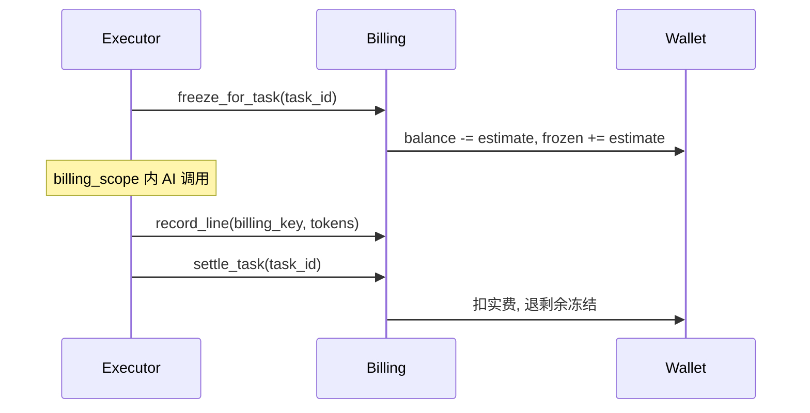

# PRINTFILM 计费说明

> 图视频现支持模型策略与站内固定价格版本。后台发布价格后，新任务按成功交付图片张数、提交视频秒数结算；上游费用只更新成本，失败不自动切换路由。未发布价格及旧历史任务沿用下述原计费规则。部署、启停和接口详见 [模型策略与站内定价](MEDIA_MODEL_STRATEGIES.md)。

团队模式使用独立钱包和按成员的上海自然月额度，任务受理时预留、执行时冻结、完成后按实结算。个人钱包不为团队垫付，充值订单与费用始终固定原团队归属。详见 [TEAM_MODE.md](./TEAM_MODE.md)。

## 原则

- 按上游 **真实 TokenFree 成本**（或无法拿到 usage 时的保守估价）计费。
- 用户支付价 = TokenFree 官方成本，**不再加价**。
- 钱包单位：**分（fen）**。
- 充值：易支付 [pay.gitcc.com](https://pay.gitcc.com/)，支付宝 `alipay` / 微信 `wxpay`；也支持 Stripe 托管 Checkout（`stripe`，需服务端启用）。
- **所有 AI 调用**均关联 `task_run_id`（单次聊天/API/工具调用创建轻量 TaskRun）。
- 本地按时长估算的视频 tokens 使用 `tokens_estimated` 标记，不能被识别为上游实测用量；实际费用仍优先取上游账单。
- 画布视频下载中断时保留原上游任务号，按退避策略重试获取成片，不重新创建视频生成请求；超过重试上限后保留原任务号供排查。
- 钱包余额写入使用 PostgreSQL `FOR NO KEY UPDATE` 行锁，保持扣款互斥，同时允许 `usage_events` 对用户主键的外键校验，避免与画布资产、任务状态写入形成循环等待。资产生图/视频落库失败后先回滚，再记录原始异常和失败状态。

## 公式

**有上游成本时（优先）**：

```
charge_fen = cost_fen
```

**按 token 估价时**：

```
charge_fen = ceil(tokens / 1e6 * provider_yuan_per_m * 100)
```

默认成本价（元/百万 tokens，可环境覆盖）：

| billing_key | 成本 |
|-------------|------|
| seedance2:video0 | 46 |
| seedance2:video1 | 28 |
| llm_chat | 5 |
| seedream | 8（按次折合约；有上游费用则优先） |
| tts | 2（按次估价） |

### TokenFree / New API（quota 计费）

上游统一走 TokenFree。单次调用若返回 `usage.quota` / `quota_consumed`，按 New API 额度折人民币：

```
cost_fen = ceil(quota / 500000 × BILLING_USD_CNY × 100)   # 500000 quota = 1 USD
charge_fen = cost_fen
```

`BILLING_USD_CNY` 默认 **7.3**，与 TokenFree 控制台一致。价目 `billing_expr` 里常见系数已含 `/7.3` 折美元，本站兑回人民币必须用同一汇率，否则会系统性少扣约 4%。

### Seedance（对齐 TokenFree Ark 渠道导出）

渠道公式（2026-10-15）：

```
billing_expr USD sell = official_CNY / 7.3 * 1.5
本站人民币 = official_CNY × 1.5
```

火山刊例（元/百万 tokens，写入 `billing_expr` 的分子）：

| 模型 | 480p/720p 无视频 | 1080p 无视频 | 含视频输入 |
|------|------------------|--------------|------------|
| seedance-2.5 | 70 | 77 | 42 / 46（1080p） |
| seedance-2.0 | 46 | 51 | 28 / 31（1080p） |
| seedance-2.0-fast | 37 | — | 22 |

无上游 `tokens` 时按输出像素估：`tok/s ≈ W×H×24/1024`（480p≈1万、720p≈2.2万、1080p≈4.9万）。本站将 TF 导出的完整 `billing_expr` 固化进 `tokenfree_pricing.SEEDANCE_TF_BILLING_EXPR`，启动拉价后强制覆盖 Seedance 三条，避免公开 `/api/pricing` 漂移。`seedance-2.0-mimi`（笔误）与 mini 一并规范到 `seedance-2.0`。

对照：5s · 1080p · 2.5 · 无视频 ≈ 24.5 万 tok × 77 × 1.5 / 1e6 ≈ **¥28.3**（预扣再 ×`billing_estimate_buffer`）。

未返回 quota 时，结算前再查 New API 消费日志 `GET /api/log/self`（type=2）。能按模型、token 或上游任务号唯一对上的，用该条 `quota` 实扣（已含分组倍率）。对不上则按公开价目 `GET /api/pricing` 核实后的规则报价，分组倍率按 1：

- `billing_mode=tiered_expr`：任务表达式（含 `u("seconds")` 等）结果就是美元；token 表达式系数是美元/百万 tokens
- `quota_type=1`：`model_price` 美元/次
- 其余：`model_ratio` / `completion_ratio`（`model_ratio=1` 为 2 美元/百万 tokens）

`model_ratio=37.5` 且没有表达式时仍视为占位，视频回退本站秒价表，不要拿 37.5 当秒价。价目未收录时，生图才回退 Kie 积分档。

管理端「支付与计费」可「查询 TokenFree 余额」（`GET /v1/dashboard/billing/subscription` + `usage`），并拉取公开价目展示推荐模型官方价。

预扣：生图 API 按逻辑模型路由解析出的上游模型名原样调用 TokenFree（如渠道启用的 `gpt-image-2` / `gpt-image-2.5` / `seedream-5-0-pro`，不做硬改写；`gpt-image-2-5` 等历史写法规范到 `gpt-image-2.5`）。价目里有按次价或表达式时，预扣与结算都用该规则（例如 `gpt-image-2` 的 `model_price`），价目键会互查点分/连字符。价目缺失时 **gpt-image / sunburst** 才按 Kie 积分档保底（1K 6 / 2K 10 / 4K 16 积分；默认 3.5 分/积分）。**按张官价不再乘 `billing_estimate_buffer`（默认 1.2）**。LLM / 视频 / TTS 估价仍乘缓冲。视频有 `billing_expr` 时按表达式（分辨率 × 秒，默认无参考视频）；没有表达式才用本站秒价表。漫剧缺省按 720P。勿把 New API 的美元 `cost` 当人民币。

管理端财务按日汇总用户扣费、调用次数与 Token 用量，不再同步上游日消耗、展示成本对照或计算利润。

项目、漫剧和个人用量接口同样只返回扣费与用量；后端已移除成本报表聚合、上游账户/日用量查询和日报快照模型。结算所需的费用换算与单次消费记录继续用于核实实际扣费。

## TaskRun 计费流程

AI 短视频的图片与镜头视频分阶段预占，只计尚未交付的素材。视频快照与执行共用分镜 `segment_script` 的段落时长、站点时长边界、声音开关、清晰度及画幅；不再只按旧 `shot.duration` 截整后预占。图片任务同时预留固定画风图、用户图与前镜引用槽位，视频任务预留本镜图片与前镜尾帧槽位，超过模型参考图上限时在受理阶段拒绝，不等付费调用后才发现参数不兼容。

任务中心分别展示「预估」「冻结状态」「实扣」「退款」与用量计费依据；未结算时实扣应显示未结算，而不是已消费 0 元。冻结是任务的预留金额，不是额外收费；总费用不能把冻结和实扣相加。取消/失败后按既有结算逻辑释放冻结，并保留真实已发生的上游用量。

上游请求记录使用 `task_events` 的 `upstream.request.started/accepted/failed/poll` 事件，与 `billing_scope` 内的任务关联。记录真实 HTTP 方法、路径、模型、上游任务 ID、HTTP 响应码与耗时，以及脱敏后的请求/响应；内部任务参数不是实际 HTTP 请求体。轮询按状态变化采样，不按每轮重复刷事件。没有历史记录时显示「未记录」，不能事后伪造。请求日志不替代 `usage_events` 的真实计费依据，也不因日志写入失败重新提交上游。

管理端列表与详情仅返回有界事件窗口，`upstream_events` 独立保留上游记录，避免大量历史调度事件挤掉请求证据。完整历史通过 `/api/admin/tasks/{id}/events` 分页查询，上游页签按 `event_type_prefix=upstream.request.` 筛选；分页只限制读取，不删除数据库日志。上游事件数量不等于网络请求次数，开始与响应事件使用同一 `request_id` 关联。

运行时间分为排队等待（创建→开始）、执行时间（开始→结束或现在）、总耗时（创建→结束或现在）。HTTP 请求耗时与上游排队/生成时间分别展示，不将本地 Worker 运行时间等同于上游处理时间。

每个 `TaskRun` 独立走「预扣 → 记录用量 → 结算」：



### 关键字段

**`usage_events`**（用量行）：

| 字段 | 说明 |
|------|------|
| `task_run_id` | 关联 `task_runs.id`（历史数据可空） |
| `domain` | `kepu` / `drama` / `studio` / `api` |
| `capability` | `llm` / `image` / `video` / `tts` |
| `estimated` | 无上游 usage 时为 `true` |
| `settled` | 任务结算后标记 |

**`task_runs`**（计费快照）：

| 字段 | 说明 |
|------|------|
| `billing_estimate_fen` | 预扣估算额 |
| `billing_charged_fen` | 结算实扣额 |
| `billing_refunded_fen` | 结算退回额 |
| `billing_status` | `none`（未预扣）/ `frozen` / `settled` / `skipped`（预扣时跳过，结算后变 `settled`） |

**`wallet_ledger`**：`ref_type=task_run`、`ref_id={task_id}` 记录 freeze / unfreeze / settle。

### 模块入口

| 场景 | 计费方式 |
|------|----------|
| 科普 pipeline / 单镜重生 | 任务平台 executor 自动 freeze/settle |
| 漫剧剧本/分镜/资产（异步） | `create_task` 入队，handler 内 `record_line` |
| 漫剧聊天 / Skill 优化 / 音色描述 | `run_billed_ephemeral`（见下表） |
| 科普选题扩写 | `run_billed_ephemeral(domain=kepu, content_expand)` |
| 漫剧资产 seed（轻量同步） | `run_billed_ephemeral(domain=drama, seed_assets)` |
| 工作室工具 | `run_billed_ephemeral(domain=studio, tool_image/tool_video)` |

### LLM 操作全清单（`billing_key=llm_chat`）

| 用户功能 | domain | task_type | 模式 |
|----------|--------|-----------|------|
| 科普选题扩写 | `kepu` | `content_expand` | 同步 ephemeral |
| 科普分镜编剧 | `kepu` | `project_pipeline`（script 阶段） | 异步任务 |
| 漫剧助手聊天 | `drama` | `agent_chat` | 同步 ephemeral |
| Skill 优化提示词 | `drama` | `skill_optimize` | 同步 ephemeral |
| 角色音色描述 | `drama` | `voice_prompt` | 同步 ephemeral |
| 剧本摘要 | `drama` | `script_summary` | 异步任务 |
| 分集大纲 + 分集正文 | `drama` | `episode_script` | 异步任务（大纲与每集各记 llm_chat） |
| AI 分镜 | `drama` | `fragment_plan` | 异步任务 |
| 资产抽取 / 刷新提示词 | `drama` | `seed_assets` | 异步或同步 ephemeral |
| 资产生图前视觉提示词 LLM | `drama` | `asset_image` / `fragment_video` 等 | 嵌套于父任务 billing_scope |

嵌套 LLM（如 `visual_prompt`）在父任务 `billing_scope` 内通过 `record_llm_chat_line` 追加用量行；无 scope 时由 seed 等路径聚合计费，避免重复。

**不计 LLM 的场景**：分镜规则回退（`rules_fallback`）、分集大纲已就绪跳过大纲 LLM、Skill 优化未勾选任何 Skill。

科普分阶段：`project_pipeline` 的 `script` / `assets` / `videos` 各对应一次 TaskRun，各自独立预扣与结算（旧 payload `produce` 兼容映射为当前下一段）。成片走 `project_compose_only`（几乎不预扣）。阶段判定与 pipeline 共用 `kepu_stages`（含整片旁白文件就绪）。

`awaiting_poll` 分镜视频：executor 提前返回时不结算；轮询完成标 `succeeded` 时 `settle_task`。

余额不足：`freeze_for_task` 失败 → HTTP 402（`create_task` 入队前同步预检，或轻量任务预扣失败）。

全局关闭计费（`BILLING_ENABLED=false`）：预扣时 `billing_status=skipped`（不冻钱包）；`settle_task` 后标 `settled`，usage 行 `settled=true`（仅统计，不扣钱包）。

余额不足失败：`billing_status` 保持 `none`（未成功预扣，勿与全局关闭计费的 `skipped` 混淆）。

api/studio 轻量视频：`awaiting_poll` 由 Selector 后台轮询；超过 `ark_video_poll_timeout` 自动失败并解冻。

## 易支付

环境变量（密钥勿提交仓库）：

```
BILLING_ENABLED=true
BILLING_MARKUP=1.0
BILLING_KIE_FEN_PER_CREDIT=3.5
EPAY_API_URL=https://pay.gitcc.com
EPAY_PID=your-epay-pid
EPAY_KEY=***
EPAY_NOTIFY_URL=https://your-site.example.com/epay/notify
EPAY_RETURN_URL=https://your-site.example.com/pricing?paid=1
```

下单：服务端 `POST {EPAY_API_URL}/mapi.php`（扫码），MD5 签名。异步 notify 验签成功 → 订单入账（幂等）。

## Stripe Checkout

Stripe 使用现有人民币充值套餐，按网站语言收款：中文 `cny`、英文 `usd`。`amount_fen` 和 `credit_fen` 仍为人民币分，钱包到账（含赠送额度）由套餐确定。外币付款金额由服务端按后台人工设置的汇率自动换算，不必逐个套餐配置外币价格；不自动抓取实时汇率，且关闭 Stripe Adaptive Pricing，避免重复换算。银行卡资料在 Stripe 托管页面填写，前端不需要 Stripe publishable key，服务端密钥不得放入前端环境变量。

在管理端 **系统设置 → 支付计费 → Stripe 支付接入** 中填写配置，先使用 Stripe 测试环境：

- 启用 Stripe 支付。
- API 密钥：Stripe 测试环境的 `sk_test_...`。
- Webhook 签名密钥：对应事件端点的 `whsec_...`。
- 前端返回地址：本地可填 `http://localhost:5173`，生产填写实际 HTTPS 前端站点地址。
- 收款币种固定按网站语言选择。填写美元汇率「1 美元 = 多少人民币」；未配置时中文 CNY 仍可用，英文 USD 暂不可用。

例如管理员手动设置 `1 USD = 7.20 CNY`，则人民币售价 ¥990 的套餐需支付 US$137.50；这只是说明计算方式的假设汇率，不是实时市场报价。公式为 `外币金额 = 人民币售价 ÷ 配置汇率`，使用 Decimal 计算并四舍五入至美分。后台汇率支持最多六位小数，必须为正数；人民币收款不需要汇率。

创建订单时保存 `payment_currency`、`payment_amount_minor` 和 `payment_exchange_rate`。收银台及回调只使用该订单固定的付款币种、外币最小单位金额和汇率，后续修改配置不会改变已创建订单。付款成功仍按原套餐 `credit_fen` 增加人民币余额，不用新的汇率倒算到账金额。历史三个字段均为空的订单按原人民币价格处理。

保存后刷新当前服务的运行配置，无需重启后端。密钥加密保存到数据库，读取设置时密钥始终返回空串，仅返回是否已配置。密钥输入留空表示保留原值；使用对应的明确清除操作才会删除，数据库中的显式清空也会覆盖环境变量旧值。

以下后端环境变量可作为首次部署的可选初始值；管理端保存的数据库配置优先：

```dotenv
STRIPE_ENABLED=true
STRIPE_SECRET_KEY=sk_test_...
STRIPE_WEBHOOK_SECRET=whsec_...
STRIPE_FRONTEND_URL=http://localhost:5173
STRIPE_CURRENCY=auto
STRIPE_USD_CNY_RATE=
```

前端返回地址留空使用 `PUBLIC_BASE_URL`。仅当 Stripe 已启用、密钥齐全、返回地址有效且选定币种能生成有效报价时，`GET /api/billing/skus` 的 `pay_types` 才包含 `stripe`，每个套餐额外返回 `stripe_quote`。管理端的 `stripe_ready` 就绪状态仅检查配置完整性，不代表已与 Stripe 完成支付联调；可复制的 `stripe_webhook_url` 取自 **站点工具 → 后端公网基址**（`PUBLIC_BASE_URL`），与用户端支付返回站点分别配置。

登录后调用 `POST /api/billing/orders`，请求体为 `{"sku_id":"topup_49","pay_type":"stripe","language":"zh"}`，英文模式传 `language="en"`。响应中的 `pay_mode` 为 `redirect`，浏览器跳转 `payurl` 进入 Stripe Checkout。Checkout 有效期为 31 分钟，在 Stripe 最少 30 分钟的要求上预留 1 分钟网络延迟与时钟余量。完成和取消分别返回 `/pricing?payment=success&order=...` 与 `/pricing?payment=cancelled&order=...`；成功地址还包含 `session_id`。浏览器返回参数仅用于展示和查询订单，不能作为到账依据。收银台尚在创建、未绑定会话时，关闭订单返回 409，稍后可重试。

在 Stripe Dashboard 的 Webhooks 中配置当前账户的 **Snapshot** 事件端点：`https://your-site.example.com/api/billing/stripe/webhook`，监听以下事件，并把该端点的签名密钥填入管理端的 Webhook 签名密钥：

- `checkout.session.completed`
- `checkout.session.async_payment_succeeded`
- `checkout.session.async_payment_failed`
- `checkout.session.expired`

服务端使用原始请求体和 `Stripe-Signature` 验签，校验会话关联、订单归属、订单固定的付款币种和金额及支付状态后入账。同一订单的重复通知只入账一次。已关闭订单若收到有效的实际支付成功通知，仍会补记到账，避免付款后因回调延迟丢失余额。异步支付未成功前不增加余额。

外币功能增加三个可空订单字段。默认启动会执行增量结构检查；已有库关闭 `DATABASE_BOOTSTRAP_ENABLED` 时，在 `backend` 目录先执行 `.venv\Scripts\python.exe scripts/prepare_stripe_payment_schema.py`，再运行相同命令加 `--check` 只读核验，之后重启后端。迁移只添加这三个字段，不改写历史订单；可重复执行。回退时先切回 CNY，等待已创建的外币订单完成或过期，再回退代码，并保留新增列。删除列会丢失财务报价记录，因此不提供自动删除字段的 DOWN 操作。

本地联调时，安装并登录 [Stripe CLI](https://docs.stripe.com/stripe-cli)，启动后端后运行：

```powershell
stripe listen --events checkout.session.completed,checkout.session.async_payment_succeeded,checkout.session.async_payment_failed,checkout.session.expired --forward-to localhost:8000/api/billing/stripe/webhook
```

把 CLI 输出的 `whsec_...` 填入管理端的 Webhook 签名密钥并保存，无需重启；CLI 签名密钥与 Dashboard 端点密钥不同。打开充值页，选择 Stripe 并创建订单，使用 Stripe 测试卡 `4242 4242 4242 4242`、任意未来有效期和测试 CVC 完成支付。确认返回页实际查询到订单 `paid`，余额只增加一次且存在对应充值流水；重发该订单事件后余额不再增加。再验证取消支付和会话过期不增加余额。不要用测试卡发起真实环境交易。

上线前需切换为正式环境密钥，配置可公网访问的 HTTPS webhook，并用正式配置完成端到端验收。代码测试不代表已完成真实 Stripe 商户联调。实现依据见 [Checkout Session API](https://docs.stripe.com/api/checkout/sessions/create)、[Webhook 验签与重试](https://docs.stripe.com/webhooks)、[支付币种](https://docs.stripe.com/currencies)。

## API

| 方法 | 路径 | 说明 |
|------|------|------|
| GET | `/api/billing/usage/summary` | 本月 token / 费用 / 余额 |
| GET | `/api/billing/orders` | 充值订单列表 |
| GET | `/api/billing/skus` | 充值套餐与可用 `pay_types` |
| POST | `/api/billing/orders` | `{sku_id, pay_type}` → 易支付扫码或 Stripe Checkout 跳转 |
| POST | `/api/billing/epay/notify` | 易支付回调 |
| POST | `/api/billing/stripe/webhook` | Stripe 原始请求体验签回调 |
| GET | `/api/admin/usage-events` | 管理端用量明细分页 |
| GET | `/api/admin/tasks/{id}` | 任务详情含 `usage_lines` 与计费字段 |
| GET | `/api/admin/stats` | 充值、扣费、调用趋势与用户排行 |
| GET | `/api/admin/finance/daily` | 近 N 日用户扣费、调用次数与 Token 用量 |

## 管理端

- **设置 → 支付与计费**：配置支付接入、用户计费及消费提醒；图片与视频价格独立发布。
- **系统设置 → 支付计费 → Stripe 支付接入**：管理 Stripe 开关、API 密钥、Webhook 签名密钥和前端返回地址，密钥留空保留、明确清除才删除，保存后生效。
- **订单与流水** → 「用量明细」Tab：按用户/任务/领域筛选 `usage_events`。
- **任务队列** → 列表「费用」列显示 `billing_charged_fen`（冻结中显示预扣）。
- **任务详情** → 「计费」Tab：预扣/实扣/退回 + 用量行列表。
- **仪表盘 → 财务账单**：充值、用户扣费与最近已支付订单。
- **财务列表**：按日展示用户扣费、调用次数、Token 及汇总，无需配置上游查询密钥。

## 验收清单

1. 科普：确认分镜只冻出图+配音；继续生成视频另冻视频段；合成走 compose。各阶段任务结束按实际用量结算。
2. 漫剧分镜视频/资产生成：有 `task_run_id` 的用量行，任务结束扣费。
3. 漫剧聊天 / 选题扩写 / Skill 优化 / 音色描述 / 工作室工具：响应含 `task_id`（轻量 TaskRun），余额变化正确。
4. 管理端可按 `task_run_id` 或 `billing_key=llm_chat` 查到每条 LLM/图/视频/TTS 费用。
5. Seedance 视频成功后 `usage_events.estimated=false` 且 `total_tokens` 与官方任务查询一致。
6. 财务列表支持按时间范围汇总本地扣费与用量，仪表盘和订单用量不显示上游成本、利润或官方对照。
7. 单次调用若带 New API `quota` / `quota_consumed`，原计费规则仍按额度折人民币结算；图片与视频启用站内价格时按已发布价格扣费。


团队模式现按所有者个人账户统一付款，同时限制团队总月额度与成员月额度；任务保存受理时付款人，转让不改变旧任务扣款对象。团队充值/独立调账入口已停用，历史账目兼容规则见 [TEAM_MODE.md](TEAM_MODE.md)。


### Stripe 按网站语言选择币种

后台 Stripe 固定按网站语言选择币种（stripe_currency=auto）：中文使用 CNY，英文使用 USD。只需要在后台设置 stripe_usd_cny_rate（1 USD 对应多少 CNY，精确小数字符串）；美元支付最小单位 = 人民币套餐分 ÷ 汇率，四舍五入到美分。站内额度和赠送仍使用原套餐 credit_fen。无需 Stripe 产品价格或 Adaptive Pricing。

用户端报价 GET /api/billing/skus?language=zh|en，下单 POST /api/billing/orders 传 language，均默认 zh。前端切换语言后重新取服务端报价，加载期间不可购买旧语言报价。服务端选择币种并固定订单金额、汇率；前端传入金额或币种不生效。Checkout 也使用对应的中文/英文界面，并关闭 Adaptive Pricing，防止客户地区再次改变报价。旧订单不因语言或后台汇率变化而改价。

未配置美元汇率时，中文 Stripe 仍可使用；英文隐藏 Stripe 并显示配置提示，直接用英文下单返回 503。后台 stripe_ready 表示两种语言配置均完整。后台界面只提供美元汇率，保存时统一使用按语言选择模式；历史订单仍使用原始币种快照。
