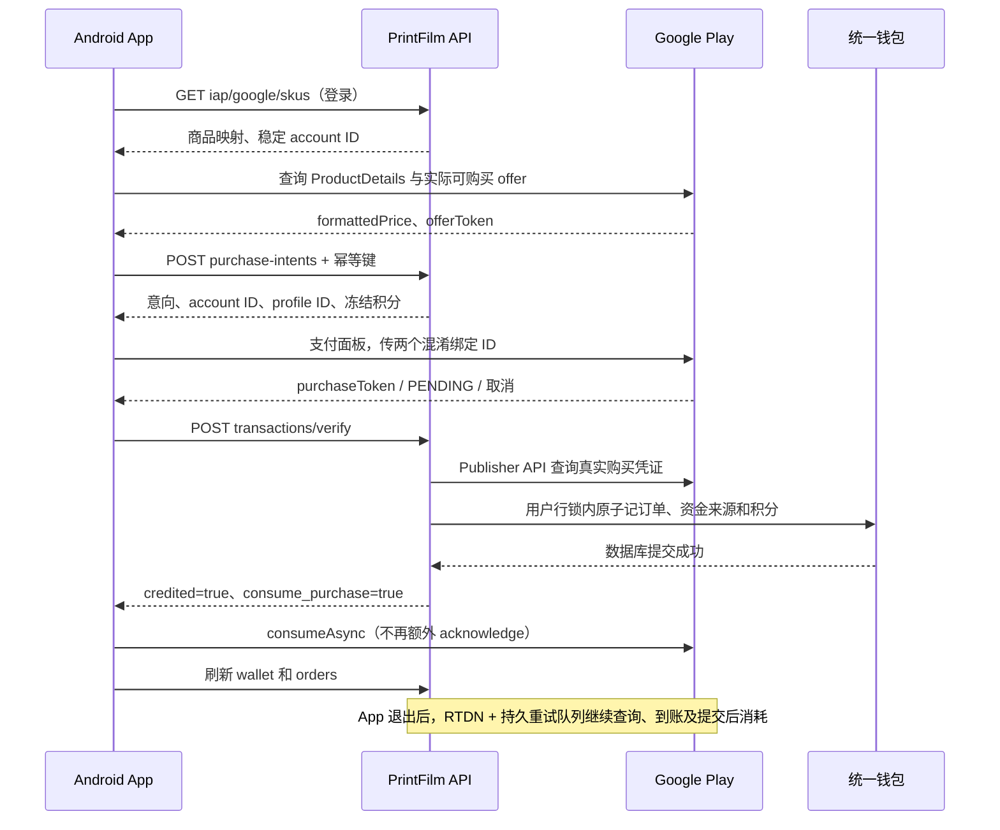

# 国际版 Android Google Play 充值联调

更新：2026-11-12。后端、管理后台和静态 OpenAPI 已接入；本仓库没有 Android 工程。实际支付仍须完成 Google Play 内部测试轨道验收，不把后台保存成功视为商品已可售。

## 余额和商品

复用同一账号、`GET /api/billing/wallet` 和现有统一钱包；`credit_fen` 是整数积分，不是当地货币金额。Web、iOS、Android 充值均能用于既有 AI 与视频解锁，充值不自动购买视频。Apple 和 Web 定价、AI 扣费规则不变。

默认商品对应：`topup_10 → printfilm_credits_trial`、`topup_49 → printfilm_credits_basic`、`topup_99 → printfilm_credits_plus`、`topup_199 → printfilm_credits_pro`。首次保存商品时读取共同套餐的额度和人民币参考金额；现有默认额度分别为 10,000 / 49,000 / 104,000 / 220,000 积分，以保存时服务器套餐为准。新商品只能使用标准 `buy` 购买选项，关闭多数量购买，不配置 offer、租赁、预购或订阅。

登记后冻结商品的 SKU 和额度，改价不改变积分。变更额度须停用旧商品、新建 product ID；旧映射不能删除，历史意向保存独立快照。

## 系统管理配置

管理后台“支付与通知”设置面板新增“Google Play 安卓支付”，无需 `.env`：

1. 点击“读取配置与交易状态”，核对 Android 包名 `com.deep.printfilm`。
2. 上传 Google service-account JSON。须启用 Android Publisher API，并在 Play Console 给该应用授予购买查询、订单/退款查询及消耗所需权限。后台加密保存凭证，不回显私钥。更换凭证不改变既有账号绑定 ID。
3. 核对四档商品映射、英文名称和开关，保存后由共同套餐冻结积分。客户端必须使用接口返回的商品 ID，不能照文档写死额度。
4. 配置 Pub/Sub 推送的 OIDC audience 和推送身份服务账号邮箱；精确匹配 Google 签名令牌的 `aud`、`email`、`email_verified`、发行方、签名和有效期。不能以静态查询参数代替验证。
5. Pub/Sub HTTPS push 地址为 `https://<API公开域名>/api/billing/google/notifications`。将 topic 配置到 Play Console RTDN，给 Play 通知服务账号 topic 发布权限，并为 Pub/Sub 配置正确的推送认证权限。API 域名与分享网站域名可以不同。
6. 激活 Play Console 的一次性商品、`buy` 购买选项和目标市场。客户端价格只使用 Google `formattedPrice`。
7. 开启新购。关闭新购不关闭有效交易验单、自动消耗、RTDN 和退款补偿；清除服务账号凭证会阻断这些功能，不能用“清凭证”代替停购。

配置接口：`GET/PATCH /api/admin/settings/google-play`，需管理员。PATCH 携带 `version`、至少三字 `reason`、配置字段和可选 `service_account_json`；空值保留凭证，`clear_credentials=true` 明确清除。版本冲突返回 409。原配置、变更后配置和修改理由写审计，审计不存明文私钥。`GET /api/admin/settings/google-play/transactions` 查看最近交易，不暴露 purchase token。

## 测试资金隔离

Google `purchaseType=0` 由服务端查询识别为许可测试付款，不能根据客户端 test 标志判断。**本次 Google 测试采用独立 Sandbox 钱包部署/数据库**，并核验后台 Google 测试用户白名单；Production 钱包部署拒绝测试付款，不改正式账户环境、不自动补发正式积分。不能直接在生产开启许可测试付款。此规则与 Apple 已有的同部署隔离测试账本不是同一条接入路径。

Sandbox 部署的 `/api/billing/wallet` 仍读取其测试数据库中的统一钱包，测试充值可用于该部署的 AI 和视频测试，不污染生产。测试用 User/WalletAccount 也必须已完成对应环境的初始化核对。

## 客户端流程



共同前缀 `/api/marketplace/app/v1/iap/google`。使用当前 API base URL，登录 Bearer、`Accept-Language: zh-CN|en-US`。响应 `Cache-Control: no-store`，无重定向。该渠道意向 `expires_at` 采用有时区 UTC ISO 时间，供现有 Android 客户端解析。

### 查询商品

`GET /api/marketplace/app/v1/iap/google/skus`

```json
{
  "package_name": "com.deep.printfilm",
  "purchasing_enabled": true,
  "obfuscated_account_id": "<服务器持久化64位随机标识>",
  "skus": [{"sku_id":"topup_10","product_id":"printfilm_credits_trial","name":"PrintFilm Trial Credits","credit_fen":10000,"purchase_option_id":"buy","offer_id":null,"enabled":true}]
}
```

真实接口返回所有可售商品。账号标识使用持久化的不透明随机值，不包含邮箱、手机号、用户 ID、Bearer；密钥轮换不会使旧标识失效。首次 GET 会保存映射，因此钱包维护时该请求也受写入屏障保护。

### 创建意向

`POST /api/marketplace/app/v1/iap/google/purchase-intents`

```http
Idempotency-Key: checkout-uuid
```

```json
{"package_name":"com.deep.printfilm","sku_id":"topup_10","product_id":"printfilm_credits_trial","idempotency_key":"checkout-uuid"}
```

```json
{
  "package_name":"com.deep.printfilm","intent_id":"<不透明字符串>",
  "sku_id":"topup_10","product_id":"printfilm_credits_trial","credit_fen":10000,
  "obfuscated_account_id":"<稳定账号标识>","obfuscated_profile_id":"<该意向唯一标识>",
  "expires_at":"2026-11-12T10:30:00+00:00"
}
```

请求头和正文幂等键必须相同；同账号同 key 不同内容返回 `GOOGLE_IDEMPOTENCY_CONFLICT`。客户端将两个绑定 ID 分别传给 BillingClient 的 `setObfuscatedAccountId`、`setObfuscatedProfileId`。意向到期不能用来拒绝已经发生的真实付款；验单核对实际购买时间与原意向。一个意向不能绑定两个 purchase token。

### 验单到账

`POST /api/marketplace/app/v1/iap/google/transactions/verify`

```http
Idempotency-Key: google-<purchaseToken的SHA256小写十六进制>
```

```json
{
  "package_name":"com.deep.printfilm","product_id":"printfilm_credits_trial",
  "purchase_token":"<Google原始purchaseToken>","quantity":1,
  "intent_id":"<原意向，可省略>","obfuscated_account_id":"<可省略>","obfuscated_profile_id":"<可省略>"
}
```

```json
{
  "package_name":"com.deep.printfilm","product_id":"printfilm_credits_trial",
  "purchase_token_sha256":"<真实64位小写SHA256>","order_id":"GPA.xxxx-xxxx-xxxx-xxxxx",
  "status":"credited","credited":true,"consume_purchase":true,"credit_fen":10000
}
```

当前使用 Publisher `purchases.products.get` 查询包名/商品/token 对应购买，校验数量、状态、Google 返回的 account/profile ID、订单号和购买时间。绑定必须能定位原意向，重装时不能以当前登录账号和商品 ID 临时认领。客户端绑定字段仅交叉核对。

成功状态 `credited` / `already_credited` 均返回两个 true，仅在资金事务提交后返回消耗许可。`pending`、`cancelled`、`refunded` 返回 false，不消耗、不加积分。归属冲突 HTTP 409：`{"code":"GOOGLE_ACCOUNT_MISMATCH","detail":"…"}`。参数错误 422 不回显 token，网络/Google 服务错误返回 503 供重试。金额或商品状态不可确认时不伪造成功。Google 请求在资金事务之外，资金操作共用 User 行锁；`(package_name,token_hash)`、Google 订单号和意向绑定唯一。

## 可靠履约、退款和财务

- token 加密落库，公开响应只包含 SHA256；HTTPX 的 Google 请求日志脱敏 token 路径。订单和资金流水不记录原始 token。
- 已验证 PENDING 和 RTDN token 进入持久队列。数据库租约允许多 API 实例、重启及超时恢复，持续退避重试。到账提交后自动 consume，客户端已消耗时通过 Google `consumptionState` 确认，不把任意错误当作成功。
- RTDN 经 OIDC 验证后按 message ID 去重落库，再查询 Google；通知正文不是付款/退款凭证。通过 profile ID 找到原账号，App 不在线仍可到账。未知撤销通知由 Voided Purchases 查询补偿。
- 自动分页查询 Voided Purchases，持久保存时间窗口、分页 token 和租约，首次覆盖近 29 天，之后有重叠回扫。每页提交后推进，失败不跳页。超过 Google 可查询保留窗口的停机不能自动保证补齐，需核对 Play 财务记录。
- 已确认撤销保存永久 token 墓碑，晚到的成功通知不能重新发币。充值退款复用原资金追偿、AI 冻结待办、欠费与偿还链、视频权益撤销和收益冲正规则；已人工打款仍形成待抵扣记录，不改历史打款。
- `/api/billing/orders` 中 `pay_type=google_play`，保留共享订单结构。Google 产品购买 API 不提供可信实付金额时，`currency`、`amount_micros`、`amount_fen` 返回 null，不能用人民币参考价或 iOS 售价冒充。兼容订单内部 `amount_fen` 仍是人民币基准快照，不是 Google 实收；对外接口已覆盖为空。
- 当前 Google 资金来源标为 `pending_fx`，成本未确认、不可参与创作者打款。**本期未实现 Google 财务报表导入及成本核算/渠道费结算入口**；须后续接入可信报表并核对原币、micros、历史汇率、分摊及费用后才可开放相关收益结算，不能手动把待核算来源直接改为已对账。用户充值与消费不受金额待同步影响。
- 新增结构沿用 API 启动统一数据库锁、幂等新增，不自动重算历史余额。钱包迁移维护时 HTTP 写入、商品绑定 GET 和后台金融任务均遵守同一屏障。

## 验收及发布

本地自动化覆盖幂等、跨账号、PENDING 转支付、过期意向付款、测试隔离、退款后延迟成功、AI 消费欠费、提交失败回滚、后端消耗失败重试、OIDC 身份与 audience、商品冻结快照及订单超时兼容。SQLite 回归不代表 PostgreSQL 并发锁验收。

上线前在测试部署使用 Play 安装的测试轨道版本验证四档商品、真实许可测试付款、断网/杀 App、客户端和后台同时消耗、RTDN 到账、退款及 Voided 补偿；再做 PostgreSQL 并发/故障恢复和生产付款验收。Google 账号、商品、IAM、Pub/Sub、支付确认时限以 Google 实际配置和官方文档为准。

官方参考：[服务端安全](https://developer.android.com/google/play/billing/security)、[ProductPurchase](https://developers.google.com/android-publisher/api-ref/rest/v3/purchases.products/get)、[消耗](https://developers.google.com/android-publisher/api-ref/rest/v3/purchases.products/consume)、[Voided Purchases](https://developers.google.com/android-publisher/api-ref/rest/v3/purchases.voidedpurchases/list)、[Pub/Sub 认证推送](https://cloud.google.com/pubsub/docs/authenticate-push-subscriptions)。完整契约见 [OpenAPI](openapi/marketplace-app-v1.json)。
